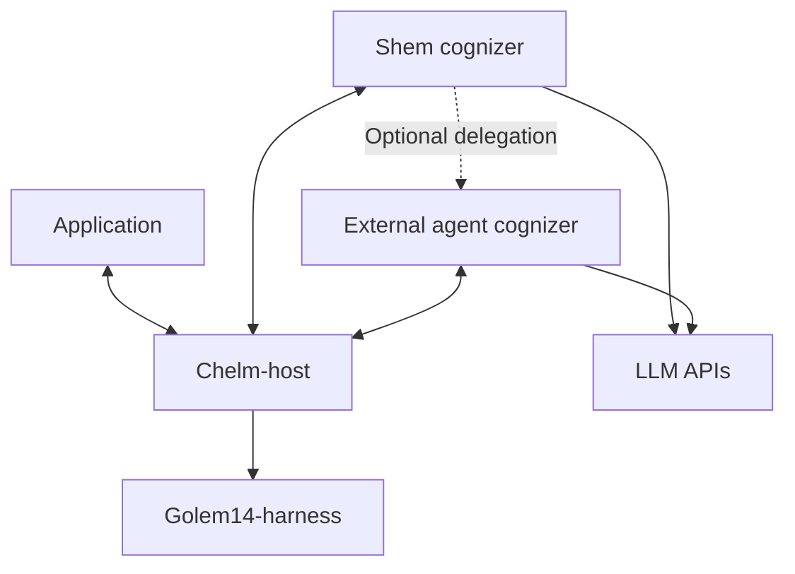

# Shem cognizer implementation plan

Status of this original plan: historical planning snapshot reviewed 2026-11-25.
A runnable implementation candidate now exists; see [current implementation and
acceptance status](IMPLEMENTATION_STATUS.md) for implemented scope, blockers and
the verified 2026-11-28 upstream pair. Statements below about planned commands and
then-published versions describe the original snapshot, not current availability.
Tracker: [#1](https://github.com/apenczolgolonabijorbiper/shem-cognizer/issues/1).

> An optional cognizer that brings Golem14-harness to life in Chelm-host through local or remote cognitive processing.

## Outcome and boundaries

Shem will perform Harness-defined cognitive work using configurable AI APIs and agent integrations. It can run beside Chelm, in an application process through an optional embedding API, or remotely as a worker. Existing compatible agents may continue to connect directly to Chelm without Shem. A local Shem installation is not required for Golem to operate.

| Component | Owns |
| --- | --- |
| Application | User experience, collection, domain purpose/profile content and permission for external actions or learning |
| Chelm-host | Authorized instance scope, durable tasks/assignments, selected storage provider, reservations/leases, snapshots, validation, publication and receipts |
| Golem14-harness | Cognitive procedures, intent/evidence/memory semantics, schemas, retrieval and validation |
| Shem or another cognizer | Interpretation, bounded retrieval/inference/tool coordination, result preparation, recovery and truthful provenance |
| LLM API / delegated agent | Inference or a bounded delegated task under the cognizer's configured policy |

Shem owns the inference client and optional agent/tool clients. Chelm's MCP server exposes host operations to cognizers; it is not the inference engine. Host connectivity and inference strategy are independent choices. Shem can itself be an MCP client, so using Shem does not replace or preclude MCP.

Shem does not select/migrate databases, replace Git, rewrite vendor packages, forge processed-source rows, approve its own learning, execute collection requests without authorization or introduce a mandatory server. The host remains the publication authority. A model/API call is one step in cognition, not the complete cognitive loop.

## Reuse of the base cognizer and reference succession

This plan uses the existing integrated cognitive workflow as the starting point for Shem, not merely its data formats. **Base cognizer** means the supported **Chelm + Harness + configured inference-capable agent** workflow: upstream packages supply the cognitive procedures, public APIs, prompts, worker lifecycle, runner and validation; the agent supplies actual interpretation/inference. Neither host nor Harness alone calls a model.

[#15](https://github.com/apenczolgolonabijorbiper/shem-cognizer/issues/15) inventories these assets and retained observed experience before implementing Shem's core. Classify each asset as reused unchanged, consumed through a public API, adapted into Shem orchestration, retained in the base integration or test-only. Pin versions/hashes, licensed provenance and known limitations; never certify an inherited script merely because it already exists. Preserve Harness semantics and host authority rather than creating parallel copies.

| Stage | Reference cognizer | Shem status | Base status |
| --- | --- | --- | --- |
| Initial | Existing supported base workflow | Planned, then implemented from the base procedures | Independently runnable initial reference |
| Comparative qualification | Base remains reference | Candidate; may have qualified published releases | Retained benchmark and operational alternative |
| Explicit promotion | Shem becomes the reference/recommended cognizer for new integrations | Mature against agreed retained evidence | Remains an optional supported base within its declared envelope |
| Ongoing development | Shem is the target for advanced cognition/orchestration | Receives new inference/agent features | Maintains shared-contract compatibility, security and correctness; need not duplicate every optional advanced feature |
| Later base-legacy designation | Shem remains the reference/target for new integrations | Leads cognitive feature development | Optional legacy integration under an explicitly announced support/compatibility policy; no automatic removal |

[#16](https://github.com/apenczolgolonabijorbiper/shem-cognizer/issues/16) owns the later maturity/promotion decision, after comparative acceptance #13 and a qualified release #14. Initial release and promotion are distinct milestones; promotion is not an automatic consequence of packaging or a version number. Harness remains the normative source of cognitive/memory rules even when Shem is the reference implementation.

Before running comparisons, agree the capability/task matrix, semantic quality/regression thresholds, critical-invariant rules, repeated-run coverage and resource limits. Retain the same synthetic source/policy snapshots and declared budgets for both paths; match model/settings where possible and disclose differences or unknowns. Use separate disposable runtimes or a genuinely non-publishing evaluation interface. Never run duplicate live publication as a shadow comparison.

Assess grounding, intent fulfillment, temporal/identity/history correctness, uncertainty, recovery and resource behavior. Compare meanings and valid outcomes, not byte-identical generated prose or arbitrary IDs. A known base mistake is adjudicated against original evidence and Harness contracts; it is not an error Shem must reproduce. Retain case-level observations and actual semantic verdicts rather than treating the base as an infallible oracle.

Cognizer selection belongs to explicit application/operator configuration, independently of storage/provider selection. The base works without Shem, and either cognizer may be local or remote. While Shem matures, existing integrations continue using the base. After promotion, new setup examples recommend Shem; existing deployments keep their selected path.

A switch or operational rollback stops new claims, reconciles unknown submissions/in-flight work, settles/releases assignments and then selects the other compatible cognizer against the same current runtime. It does not restore an older memory state, replay completed observations, implicitly fall back after an unknown publication, reset an instance or migrate a provider. The host's receipts and fencing remain authoritative.

Maintaining the base means preserving the existing prompts/procedures/public integrations and their declared compatibility; it does not add a new LLM API client to Chelm or Harness. Future upstream README/setup/reference-designation changes require coordinated reviewable follow-ups. This revision records that work in Shem only and does not alter either upstream runtime.

## Selecting or preferring Shem and evolving the base to legacy

[Switching guide](SWITCHING_TO_SHEM.md) and [workstream #17](https://github.com/apenczolgolonabijorbiper/shem-cognizer/issues/17) define the operator-facing transition. Ship concrete, version-qualified local CLI/stdio, remote MCP and colocated recipes with the first qualified Shem release; the current guide explicitly marks Shem commands/configuration as pending implementation.

Distinguish three planned policies: base-only, prefer-Shem and Shem-only. These are design labels, not current Chelm runtime keys or command flags. Published Chelm 1.3.0 has a pull-based worker interface and no preferred_cognizer field. Effective preference initially belongs to application/supervisor scheduling and worker eligibility; a label or max_active_work=1 cannot stop an independently polling base agent from claiming first. Any required host-enforced priority/discovery/routing is a separately implemented, negotiated and published capability.

The guide must show exact supported triplets and readiness/capability checks; preview current/desired routing and affected queues; pause old polling while preserving intake; recover unknown submissions and settle local/remote/cognitive assignments; explicitly activate Shem; verify effective process/principal, retained receipts and current memory; and support rollback by the same procedure. Base fallback may be configured before a new assignment, never as an implicit replay of owned/uncertain work. Qualify synthetic observation/task examples on disposable runtimes rather than inserting test facts into production.

Reference promotion in #16 changes the recommendation for new setup. Later, an evidence-backed **base-legacy** announcement may make Shem the target for new cognition features while retaining the optional base under a declared compatibility/support envelope. Record effective versions/date, security/correctness maintenance, support window and any removal criteria; do not invent dates or automatically rewrite installed selection. Generic independent cognizers remain compatible through public contracts.

Coordinated upstream follow-ups must link the guide from Chelm/Harness setup, examples and release notes, and specify any actually needed host capability/schema changes. Harness remains cognizer-independent. This plan does not add unsupported fields, a new model client to the host or a mandatory Shem dependency.

## Verified upstream baseline

The following is a dated planning snapshot, not a compatibility certification.

| Item | Observed identity | Consequence |
| --- | --- | --- |
| Latest published Harness | [0.14.0](https://github.com/apenczolgolonabijorbiper/golem14-harness/releases/tag/v0.14.0), release target `af3ef0e1042b4c7cd86ae05bae7d4e5c40a03b2e` | Alignment target; includes local core portability 1.0.0 |
| Latest published Chelm | [1.3.0](https://github.com/apenczolgolonabijorbiper/chelm-host/releases/tag/v1.3.0), release target `cd14af43ddf79ef57719c65d8864e42513ed26df` | Supports Harness **0.13.0 exactly** |
| Executable published pair | Chelm 1.3.0 + Harness 0.13.0 | Initial integration baseline; never substitute 0.14.0 behind Chelm's version checks |
| Latest Harness archive SHA-256 | `887f6b16b8c7c8c2b4a7b57de553e9bdf7e14f76f99adba493ac6cca45344a08` | GitHub release-asset digest, to verify against the downloaded checksum/package before use |
| Published Chelm archive SHA-256 | `ae3141ad9e6dbecf97542233cc03c8b31a74bbb5a304ca1ee73fde506ab8b159` | Same verification requirement |
| Chelm's supported Harness archive / manifest SHA-256 | `25451b801f5d411d0e35d03567fe8e6cf78d304bcb288556e0566c883cd68a6f` / `fa8ae35da38a1f64e82336ef99c46fdce35a502c2ff5ebf197e618f10e76e17b` | Published 0.13.0 pins from Chelm compatibility declarations |
| Current master snapshots | Harness `1f4307c46f1ca599487134619822c05ed1f51186`; Chelm `684cf7eb1a1991efe036938fe04e727b4f934957` | Unreleased source is inspected separately and cannot be presented as a published package |
| Chelm portable local sessions | [Source documentation at the inspected master snapshot](https://github.com/apenczolgolonabijorbiper/chelm-host/blob/684cf7eb1a1991efe036938fe04e727b4f934957/docs/LOCAL_SESSIONS.md) | Capability-gated follow-on once published and tested; not a v1.3.0 promise |

**Release dependency:** [#2](https://github.com/apenczolgolonabijorbiper/shem-cognizer/issues/2) must coordinate a published Chelm upgrade declaring/testing Harness 0.14.0, or the newer published target selected during implementation. The first release's latest-pair gate remains blocked until that mutually supported published tuple is verified. No version-check bypass or speculative version-range widening is acceptable. Recheck latest stable releases at implementation start and release freeze; development can proceed on the existing supported pair.

Relevant open upstream work is tracked as dependency context rather than assumed delivered: [Chelm portability #38](https://github.com/apenczolgolonabijorbiper/chelm-host/issues/38) and [Windows reliability/alignment #53](https://github.com/apenczolgolonabijorbiper/chelm-host/issues/53). Their open acceptance items do not disappear merely because a related test passes in Shem.

## Capability coverage

| Upstream capability | Shem integration | Plan |
| --- | --- | --- |
| Local CLI / stdio MCP / authenticated HTTP MCP | Normalized HostBinding with transport-specific aliases and authentication | [#3](https://github.com/apenczolgolonabijorbiper/shem-cognizer/issues/3) |
| Provider v1, host integration API v2, config 3 / memory-worker v3 | Bounded logical records/evidence; stage only semantic `changes.json` | [#6](https://github.com/apenczolgolonabijorbiper/shem-cognizer/issues/6) |
| Legacy config-2 local/file and remote-worker v2 | Isolated compatibility binding using issued workspaces/slots; no silent config conversion | [#6](https://github.com/apenczolgolonabijorbiper/shem-cognizer/issues/6) |
| Cognitive task/context/result v1 | Explicit cognitive queue, immutable bindings, grounded results and trusted host delivery receipts | [#7](https://github.com/apenczolgolonabijorbiper/shem-cognizer/issues/7) |
| Intent, branching messages and clarification | Stable IDs and reply links; inferred intent never authorizes actions | [#7](https://github.com/apenczolgolonabijorbiper/shem-cognizer/issues/7) |
| Optional learning-hypothesis v1 and unknown-confidence capability | Separate proposals and host/application authorization; no self-publication | [#7](https://github.com/apenczolgolonabijorbiper/shem-cognizer/issues/7) |
| Purpose/profile/vocabulary and scoped identities | Assignment-bound guidance, exact source reads, corrections, uncertainty and dependency review | [#5](https://github.com/apenczolgolonabijorbiper/shem-cognizer/issues/5) |
| Renewal, semantic rebase, integration review and retained receipts | Durable invocation recovery, reviewed changed candidates, exact retry identities | [#9](https://github.com/apenczolgolonabijorbiper/shem-cognizer/issues/9) |
| Optional model/usage telemetry and verification pointers | Actual/unknown provenance, distinct validation/publication/semantic-review outcomes | [#11](https://github.com/apenczolgolonabijorbiper/shem-cognizer/issues/11) |
| Local core portability 1.0.0 | Consume upstream contracts; own Shem SudoLang specs for inference/orchestration behavior | [#12](https://github.com/apenczolgolonabijorbiper/shem-cognizer/issues/12) |
| Portable local sessions | Later published-capability binding for checkpoint publication/resume/reset; retain host fencing | [#9](https://github.com/apenczolgolonabijorbiper/shem-cognizer/issues/9) |

No SQLite provider, migration or unsupported larger-memory capacity is implied. JSON/Git reference costs and upstream limits still apply. Shem must retain upstream `executor` wire fields for compatibility while describing its architectural role as cognizer.

## Implementation sequence and work packages

P0/P1 describe implementation priority. **The initial implementation packages and base inventory #15 are required for the first advertised release**, unless a capability is explicitly narrowed and the tracker/docs/acceptance matrix are updated together. **Reference promotion #16 is a later maturity milestone**, after at least one qualified published Shem release; it is required to complete the full succession tracker, not to publish an initial non-reference release. #17's concrete initial use/preference/switch guide is required with the first release; its later promotion/base-legacy portions follow the corresponding lifecycle decisions. There is no mock-only or pilot completion gate.

| Phase | Issue | Deliverable | Depends on |
| --- | --- | --- | --- |
| A: base inventory | [#15](https://github.com/apenczolgolonabijorbiper/shem-cognizer/issues/15) | Capture the current reference workflow, reuse map, observed evidence and comparison cases | — |
| A: contracts | [#2](https://github.com/apenczolgolonabijorbiper/shem-cognizer/issues/2) | Architecture, versioned interfaces, exact published compatibility and upstream upgrade dependency | — |
| A: specifications | [#12](https://github.com/apenczolgolonabijorbiper/shem-cognizer/issues/12) | SudoLang specs, schemas, traceability and fixture/parity framework; evolves with all later work | [#2](https://github.com/apenczolgolonabijorbiper/shem-cognizer/issues/2) |
| B: connectivity | [#3](https://github.com/apenczolgolonabijorbiper/shem-cognizer/issues/3) | Local CLI, stdio MCP and HTTP MCP worker bindings | [#2](https://github.com/apenczolgolonabijorbiper/shem-cognizer/issues/2) |
| B: inference | [#4](https://github.com/apenczolgolonabijorbiper/shem-cognizer/issues/4) | Pluggable inference and configurable OpenAI-compatible reference adapter | [#2](https://github.com/apenczolgolonabijorbiper/shem-cognizer/issues/2) |
| C: cognition | [#5](https://github.com/apenczolgolonabijorbiper/shem-cognizer/issues/5) | Bounded Harness-guided driver derived from the base workflow | [#3](https://github.com/apenczolgolonabijorbiper/shem-cognizer/issues/3), [#4](https://github.com/apenczolgolonabijorbiper/shem-cognizer/issues/4), [#15](https://github.com/apenczolgolonabijorbiper/shem-cognizer/issues/15) |
| C: observations | [#6](https://github.com/apenczolgolonabijorbiper/shem-cognizer/issues/6) | Provider semantic processing and explicit legacy compatibility | [#5](https://github.com/apenczolgolonabijorbiper/shem-cognizer/issues/5) |
| C: questions | [#7](https://github.com/apenczolgolonabijorbiper/shem-cognizer/issues/7) | Memory-backed tasks, branching conversations and separate learning proposals | [#5](https://github.com/apenczolgolonabijorbiper/shem-cognizer/issues/5) |
| C: agents | [#8](https://github.com/apenczolgolonabijorbiper/shem-cognizer/issues/8) | Configured CLI agent adapter and capability-based MCP delegation/tools | [#2](https://github.com/apenczolgolonabijorbiper/shem-cognizer/issues/2), [#5](https://github.com/apenczolgolonabijorbiper/shem-cognizer/issues/5) |
| D: recovery | [#9](https://github.com/apenczolgolonabijorbiper/shem-cognizer/issues/9) | Durable restart/reconnect, renewals, bounded scheduling and cancellation | [#3](https://github.com/apenczolgolonabijorbiper/shem-cognizer/issues/3), [#5](https://github.com/apenczolgolonabijorbiper/shem-cognizer/issues/5), [#6](https://github.com/apenczolgolonabijorbiper/shem-cognizer/issues/6), [#7](https://github.com/apenczolgolonabijorbiper/shem-cognizer/issues/7) |
| D: setup | [#10](https://github.com/apenczolgolonabijorbiper/shem-cognizer/issues/10) | Private config, credentials, operator setup and deployment recipes | [#2](https://github.com/apenczolgolonabijorbiper/shem-cognizer/issues/2), [#3](https://github.com/apenczolgolonabijorbiper/shem-cognizer/issues/3), [#4](https://github.com/apenczolgolonabijorbiper/shem-cognizer/issues/4), [#8](https://github.com/apenczolgolonabijorbiper/shem-cognizer/issues/8) |
| D–F: switch and lifecycle guide | [#17](https://github.com/apenczolgolonabijorbiper/shem-cognizer/issues/17) | Exact use/prefer/switch/rollback recipes at first release; later reference and base-legacy announcements | #2/#9/#10/#13/#14 for initial qualification; #16 for later lifecycle decisions |
| D: evidence | [#11](https://github.com/apenczolgolonabijorbiper/shem-cognizer/issues/11) | Provenance, limits, phase measurements and durable completion evidence | [#2](https://github.com/apenczolgolonabijorbiper/shem-cognizer/issues/2), [#4](https://github.com/apenczolgolonabijorbiper/shem-cognizer/issues/4), [#5](https://github.com/apenczolgolonabijorbiper/shem-cognizer/issues/5) |
| E: acceptance | [#13](https://github.com/apenczolgolonabijorbiper/shem-cognizer/issues/13) | Deterministic, semantic, real-API and actual-agent qualification | All preceding packages |
| E: release | [#14](https://github.com/apenczolgolonabijorbiper/shem-cognizer/issues/14) | Verified ZIP, installation/upgrade, exact compatibility and upstream drift maintenance | [#13](https://github.com/apenczolgolonabijorbiper/shem-cognizer/issues/13) |
| F: reference succession | [#16](https://github.com/apenczolgolonabijorbiper/shem-cognizer/issues/16) | Explicit maturity/promotion decision, optional-base support and recovery-aware selection/rollback | #15, #13, at least one qualified published release from #14 |

Base inventory begins alongside contracts; it feeds the core driver and comparison rubric. Contracts/specification work starts first. Host connectivity and the inference adapter can be implemented independently after the contracts settle. Recovery, setup and evidence design begin during core implementation rather than being retrofitted at release time.

## Proposed implementation shape

Prefer Node ES modules with a tested Node 22.12+ minimum, aligned with the upstream reference runtime. Keep dependencies explicit and locked. A remote Shem MCP client should need neither a local Harness installation nor Python/Git; those remain requirements of the owner-side reference host.

Proposed modules, not implemented interfaces:

- `core/`: bounded cognitive driver, budgets, task/observation strategies, provenance and typed errors.
- `bindings/`: local CLI, stdio MCP and remote HTTP MCP host adapters.
- `inference/`: normalized model adapter contract and OpenAI-compatible reference client.
- `agents/`: configured subprocess and explicitly negotiated delegation adapters.
- `state/`: private operational checkpoints and reconciliation.
- `schemas/`, `prompts/`, `specs/`, `fixtures/`: versioned contracts and SudoLang behavior with retained synthetic vectors.
- `bin/`, `integration/`, `tools/`: operator commands, optional embedding/setup, verification and release tooling.

Proposed commands include `doctor`, `run --once`, an explicitly bounded `run --loop`, `status`, `resume` and `stop`. Final names/JSON envelopes belong to [#2](https://github.com/apenczolgolonabijorbiper/shem-cognizer/issues/2); no command is runnable yet.

An API adapter must handle actual endpoint capabilities, streaming/non-streaming, structured output or explicit fallback, auth/proxy/trust configuration, timeouts and bounded retries. Another provider's native API requires its own qualified adapter. The generic interface alone does not establish provider compatibility.

An external agent must expose a documented invocation/result contract. MCP is not itself an agent invocation protocol. Existing Work/Cursor agents connecting directly to Chelm are a supported architectural alternative, not evidence that Shem can remotely start those products or reuse their subscription credentials.

## Processing and recovery invariants

1. Negotiate supported published contracts before claiming work. Authenticate against the configured host scope; descriptive executor/model/host fields never authorize access.
2. Recover existing work and ambiguous submissions before requesting more. Persist stable request/work/attempt/submission identities before external boundaries.
3. Read all assignment-bound protocol/guidance and required original sources through bounded public operations. Preserve hashes, Unicode offset semantics, truncation, uncertainty and pending-intake distinctions.
4. Run finite inference/tool/agent rounds. Treat observations and tool content as data; use only configured authorized tools. Renew while work is active without extending host task lifetime.
5. Prepare semantic changes or cognitive results according to the selected contract. Learning remains separate; application authorization remains outside model control.
6. Stage only issued slots, validate exact revisions, review diagnostics and revalidate any changed candidate. Host-owned ledger completion is never manufactured by Shem.
7. Submit the exact digest and stable identity. On response loss, query/recover the original receipt before retrying. Known committed work is not re-executed.
8. Retain a durable completion record with actual checks, warnings and receipt. Distinguish candidate validation, publication, semantic review and optional durable checkpoint save.
9. On stale policy/source/attempt, cancellation or reset, stop stale publication and follow the relevant host recovery procedure. Do not automatically relabel an old result.
10. Inference acceptance and external side effects may be uncertain after interruption; never promise exactly-once model execution, zero duplicate cost or successful remote cancellation without evidence.

Scheduling is an explicitly enabled Shem/application concern. Respect no-work delay, finite total limits, host quotas and observation/cognitive queue fairness. No unbounded autonomous loop or implicit new authorization is introduced.

## Acceptance and release gates

[#13](https://github.com/apenczolgolonabijorbiper/shem-cognizer/issues/13) owns an evidence matrix with these independent axes:

- Host: published exact pair, config 2 and config 3.
- Connectivity: local CLI, stdio MCP and authenticated HTTP MCP.
- Work: observation processing, read-only cognitive tasks, optional separately authorized learning.
- Inference: actual API adapter and actual delegated agent, each independently qualified.
- Platforms: Windows Server 2022, Linux and macOS on declared Node runtimes.
- Failures: malformed/hostile model output, rate limit, hangs, cancellation, lost claim/read/submit responses, process/service restart, source/policy/head changes, Unicode boundaries and cross-principal/instance isolation.
- Semantics: evidence entailment, relevance, independence, contradictions, identity, temporal correctness, uncertainty, branching replies and actual intent fulfillment.
- Reference comparison: base/Shem matched synthetic snapshot cases, declared models/budgets, repeated-run variability, adjudicated base defects and explicit criteria for the later #16 promotion.
- Selection/preference: exact local/remote recipes, competing base workers, unavailable/incompatible Shem, readiness/fallback, both queues, recovery-aware switching and rollback without resetting memory (#17).

Deterministic mocks and SDK probes establish only their measured behavior. Required real-inference or external-agent checks remain pending when credentials/environment are unavailable. Semantic verdicts are recorded case by case, with reviewer independence stated honestly. Do not retain private chain-of-thought; concise findings and verification are sufficient.

Release packaging uses an explicit allowlist, integrity/provenance manifest and SHA-256 checksum. Exclude `node_modules`, credentials, runtime state and private inputs. Install only locked declared dependencies, with an offline preparation recipe and safe failure behavior. Upgrades preserve external Shem state and all Chelm/application data; they do not reset instances or auto-select providers.

## Ongoing alignment

Every implementation PR assesses upstream contracts, normative specs, fixtures, compatibility and documentation together. A no-impact decision needs an actual reviewed rationale. Known unresolved parity drift blocks release.

Manual/scheduled repository CI should detect new upstream releases and generate a reviewable alignment report/update. It must not silently upgrade consumers. Before each release, recheck the newest stable published pair and re-run affected conformance and live semantic checks. Optional new capabilities are added only after their upstream release and Shem qualification.

## Reviewed upstream contracts

- [Harness cognition v1](https://github.com/apenczolgolonabijorbiper/golem14-harness/blob/v0.14.0/docs/COGNITIVE_TASKS.md)
- [Harness public memory provider API](https://github.com/apenczolgolonabijorbiper/golem14-harness/blob/v0.14.0/docs/MEMORY_PROVIDERS.md)
- [Harness local portability 1.0.0](https://github.com/apenczolgolonabijorbiper/golem14-harness/blob/v0.14.0/portability/README.md)
- [Chelm exact compatibility](https://github.com/apenczolgolonabijorbiper/chelm-host/blob/v1.3.0/compatibility.json)
- [Chelm provider workers](https://github.com/apenczolgolonabijorbiper/chelm-host/blob/v1.3.0/docs/MEMORY_PROVIDERS.md)
- [Chelm cognitive tasks](https://github.com/apenczolgolonabijorbiper/chelm-host/blob/v1.3.0/docs/COGNITIVE_TASKS.md)
- [Chelm remote worker contract](https://github.com/apenczolgolonabijorbiper/chelm-host/blob/v1.3.0/docs/REMOTE_WORKER_CONTRACT.md)
- [Chelm remote setup and existing external-process runner](https://github.com/apenczolgolonabijorbiper/chelm-host/blob/v1.3.0/docs/REMOTE_WORKERS.md)
- [Chelm verification-pointer rules](https://github.com/apenczolgolonabijorbiper/chelm-host/blob/v1.3.0/docs/CONTRACT_WORKER.md)

## Tracked host preference proposal

[Chelm-host #59](https://github.com/apenczolgolonabijorbiper/chelm-host/issues/59) tracks `preferred_cognizer` and enforceable new-work eligibility across local/remote bindings. It is proposed, not implemented or published. It can be developed before Shem using independent worker fixtures; the host will continue to leave inference to cognizers.

Shem must negotiate the eventual published routing capability and supported host/Harness tuple before claiming host-enforced preference. Application-controlled scheduling remains the available integration design until then. The proposal includes trusted registration, prefer/required modes, bounded fallback, effective status and prospective policy changes that preserve existing ownership and unknown-submit recovery. Its exact configuration is not accepted by current releases.
